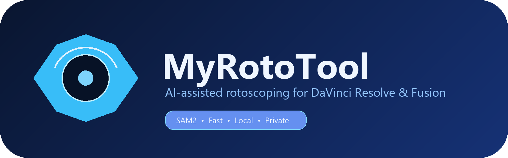

# MyRotoTool



AI-assisted rotoscoping tool for **DaVinci Resolve/Fusion** using Meta's SAM2 model. The desktop app can read the active clip from Resolve, generate a mask, preview the result, and export the mask for use in Resolve.

## Requirements

- Windows 10 or Windows 11
- Python 3.10 or newer
- DaVinci Resolve installed (the Resolve/Fusion integration requires Resolve to be open)
- Git and Git LFS
- NVIDIA GPU with CUDA is recommended for faster processing. CPU mode may work, but it is significantly slower.
- Enough disk space for Python packages, PyTorch, SAM2, and the model checkpoint

## Installation

### One-click online installer

For Windows users, download `MyRotoTool-Setup.exe` from the repository's [Releases page](https://github.com/Eltalaab/MyRotoTool/releases) and double-click it. The installer downloads Python 3.11, creates an isolated environment, installs PyTorch/SAM2 and the other dependencies, downloads the SAM2 model, creates a desktop shortcut, and starts the tool. Internet access is required during the first installation and the download may be several gigabytes because PyTorch and its runtime are large.

The installer stores the application under:

```text
%LOCALAPPDATA%\MyRotoTool
```

The installer is an online bootstrapper, so it remains small. It does not contain Python, PyTorch, or the model inside the EXE.
The installed desktop shortcut and the running MyRotoTool window use the MyRotoTool icon instead of the default Python icon.

### Manual installation

1. Install Python from [python.org](https://www.python.org/downloads/). During installation, enable **Add Python to PATH**.
2. Install Git from [git-scm.com](https://git-scm.com/downloads) and Git LFS from [git-lfs.com](https://git-lfs.com/).
3. Clone the repository:

   ```powershell
   git lfs install
   git clone https://github.com/Eltalaab/MyRotoTool.git
   cd MyRotoTool
   ```

4. Create and activate a virtual environment:

   ```powershell
   py -m venv .venv
   .venv\Scripts\activate
   ```

5. Install the dependencies:

   ```powershell
   python -m pip install --upgrade pip
   pip install -r requirements.txt
   ```

   The `sam2_hiera_tiny.pt` checkpoint is tracked with Git LFS and should be downloaded automatically when cloning the repository. If it is missing or is only a small LFS pointer file, run:

   ```powershell
   git lfs pull
   ```

### Building the installer

To build the setup EXE from source on Windows:

```powershell
.\installer\build_installer.ps1
```

The output is `installer\dist\MyRotoTool-Setup.exe`. Upload this file to a GitHub Release rather than committing it to the source repository.

## Running the application

Open DaVinci Resolve and make sure a project and video clip are active, then run:

```powershell
.\run_roto.bat
```

Alternatively, with the virtual environment activated:

```powershell
python roto_app.py
```

The application looks for the active Resolve clip and the model checkpoint in the project folder. Keep `sam2_hiera_tiny.pt` beside `roto_app.py`.

## Resolve/Fusion integration

The integration files are included in this repository:

- `LocalAIRoto.fuse` — Fusion Fuse node.
- `AIRoto_Script.lua` — Resolve/Fusion Lua integration script.
- `resolve_script_bridge.py` — bridge for running the Resolve-side integration.
- `launch_from_resolve.py` — Resolve launch and context discovery helper.
- `timeline_sync.py` — synchronizes the active Resolve timeline and clip context.
- `detect_clip.py` — detects the active clip and writes the local context file.

The exact installation location for Resolve scripts can differ by Resolve version and operating-system configuration. If Resolve does not detect the integration automatically, copy the required Lua/Fuse files to the corresponding Resolve/Fusion scripts or Fusion Fuse folder, then restart Resolve. The Python app can still be tested independently with a local video file.

## Project files

| File | Purpose |
|---|---|
| `roto_app.py` | Main desktop application and SAM2 mask generation |
| `sam2_hiera_tiny.pt` | SAM2 model checkpoint, downloaded through Git LFS |
| `requirements.txt` | Python dependencies |
| `run_roto.bat` | Windows launcher using the local virtual environment |
| `run_tests.py` | Basic project and Resolve-context checks |
| `AIRoto_Script.lua` | Resolve/Fusion Lua script |
| `LocalAIRoto.fuse` | Fusion Fuse node |
| `resolve_script_bridge.py` | Resolve scripting bridge |
| `launch_from_resolve.py` | Resolve launch/context helper |
| `timeline_sync.py` | Timeline synchronization |
| `detect_clip.py` | Active clip detection |

Generated files such as `current_clip.txt`, `node_clip.json`, `roto_storage/`, logs, the virtual environment, and the local SAM2 source checkout are intentionally ignored by Git.

## Troubleshooting

### The model checkpoint is not found

Verify that the file exists and is approximately 156 MB:

```powershell
Get-Item .\sam2_hiera_tiny.pt
git lfs pull
```

### PyTorch or SAM2 installation fails

Use a supported 64-bit Python version and update pip:

```powershell
python -m pip install --upgrade pip setuptools wheel
pip install -r requirements.txt
```

For NVIDIA acceleration, install the PyTorch build compatible with the installed CUDA driver, following the instructions on [pytorch.org](https://pytorch.org/get-started/locally/).

### No clip is detected from Resolve

Open a project, place a video clip on the active timeline, and keep Resolve open before launching the app. Also verify that the media is online and that the Resolve scripting/Fusion integration files are installed in the correct Resolve folders.

## License and third-party components

This project uses third-party packages listed in `requirements.txt`, including PyTorch, torchvision, OpenCV, CustomTkinter, Pillow, NumPy, and SAM2. Review their respective licenses before redistributing the project.
